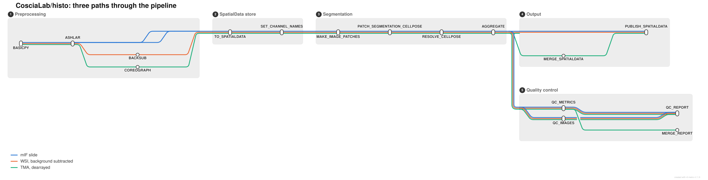

# CosciaLab/histo

Processing, segmentation and quantification of multiplex immunofluorescence (mIF) images.
Input is raw cycles in any format Ashlar reads (Bio-Formats), or a stitched OME-TIFF.
H&E is planned and not supported.

> [!WARNING]
> **Version 1.3.0.** Runs end to end on real data (mIF, TMA, WSI). The samplesheet and marker
> sheet columns are stable. QC thresholds were calibrated on a single slide, so check your results.

[](https://www.nextflow.io/)
[](https://www.nf-test.com)
[](https://sylabs.io/docs/)

## What this is

A Nextflow pipeline for imaging data from human tissue, built to run unattended on colleagues'
datasets as well as my own. It combines two existing projects:

| Source                                                | What is taken from it                                                                                   |
| ----------------------------------------------------- | ------------------------------------------------------------------------------------------------------- |
| [nf-core/mcmicro](https://github.com/nf-core/mcmicro) | Preprocessing: illumination correction, stitching and registration, background subtraction, TMA dearray |
| [nf-core/sopa](https://github.com/nf-core/sopa)       | Everything from segmentation onward: SpatialData object, tiled segmentation, aggregation, reporting     |

The handoff between the two halves is a single stitched OME-TIFF. Segmentation is tiled, so it is
size independent: images from 5 GB to 100 GB run the same way.

This is a **personal pipeline, not an nf-core pipeline**, and is not affiliated with or endorsed by
nf-core. It follows nf-core conventions for reproducibility and to keep upstream contributions open.

## Steps



Preprocessing (from mcmicro):

1. Illumination correction (BaSiCPy)
2. Stitching and registration (Ashlar)
3. TMA dearray (UNetCoreograph), optional: `--use_tma_dearray`
4. Background subtraction (backsub), optional: `--use_backsub`; per core on a TMA

Downstream (from sopa):

5. SpatialData Zarr conversion and channel naming from the marker sheet
6. Tiled cell segmentation with Cellpose, StarDist or InstanSeg, optionally skipping empty tiles
7. Aggregation of mean channel intensity per cell
8. QC report per sample, and for a TMA a merged object per slide

`use_preprocessing: false` starts from an already stitched image; `preprocessing_only: true` stops
after preprocessing. At startup the run stops if the Ashlar or Coreograph channel is not `dna` in
the marker sheet; `--skip_reference_dna_check` overrides.

## Usage

```bash
nextflow run CosciaLab/histo -r v1.3.0 \
    -profile singularity,size_small,slurm \
    -params-file params.yml
```

Needs Nextflow >= 25.10.4, a container engine and pre-staged images (no pulls at launch). Start
`params.yml` from [assets/params_template.yml](assets/params_template.yml).

## Documentation

| Doc                                                      | For         | Contents                                           |
| -------------------------------------------------------- | ----------- | -------------------------------------------------- |
| [docs/usage.md](docs/usage.md)                           | users       | Inputs, choosing parameters, profiles, the cluster |
| [assets/params_template.yml](assets/params_template.yml) | users       | Every parameter with its default                   |
| [docs/output.md](docs/output.md)                         | users       | What runs, what comes out, the QC report           |
| [docs/CONTRIBUTING.md](docs/CONTRIBUTING.md)             | maintainers | Testing, containers, the metro map                 |
| [docs/decisions.md](docs/decisions.md)                   | maintainers | Why it is built this way                           |
| [ROADMAP.md](ROADMAP.md)                                 | maintainers | Open work, known limits, verified runs             |
| [CHANGELOG.md](CHANGELOG.md)                             | both        | Release notes                                      |
| [CITATIONS.md](CITATIONS.md)                             | both        | Tools to cite                                      |

## Credits

Written by Jose Nimo at the Max Delbrück Center for Molecular Medicine, Berlin.

This pipeline is derived from two MIT licensed projects and would not exist without them:

- **nf-core/sopa**, written by [Quentin Blampey](https://github.com/quentinblampey) and
  contributors. The downstream half of this pipeline is derived from it, and many modules are
  vendored from it with their original licence headers and source commits recorded.
- **nf-core/mcmicro**, from the Laboratory of Systems Pharmacology and the nf-core community.

See [`CITATIONS.md`](CITATIONS.md) for the full list of tools and their references.

## Citations

**This pipeline has no DOI and should not be cited in place of the tools it wraps.** If you use it,
cite the underlying tools. The two most important:

> **Sopa: a technology-invariant pipeline for analyses of image-based spatial omics.**
>
> Quentin Blampey, Kevin Mulder, Margaux Gardet, Stergios Christodoulidis, Charles-Antoine Dutertre,
> Fabrice André, Florent Ginhoux & Paul-Henry Cournède.
>
> _Nat Commun._ 2024 June 11. doi: [10.1038/s41467-024-48981-z](https://doi.org/10.1038/s41467-024-48981-z)

> **The nf-core framework for community-curated bioinformatics pipelines.**
>
> Philip Ewels, Alexander Peltzer, Sven Fillinger, Harshil Patel, Johannes Alneberg, Andreas Wilm,
> Maxime Ulysse Garcia, Paolo Di Tommaso & Sven Nahnsen.
>
> _Nat Biotechnol._ 2020 Feb 13. doi: [10.1038/s41587-020-0439-x](https://dx.doi.org/10.1038/s41587-020-0439-x)

## Licence

MIT. See [`LICENSE`](LICENSE).
