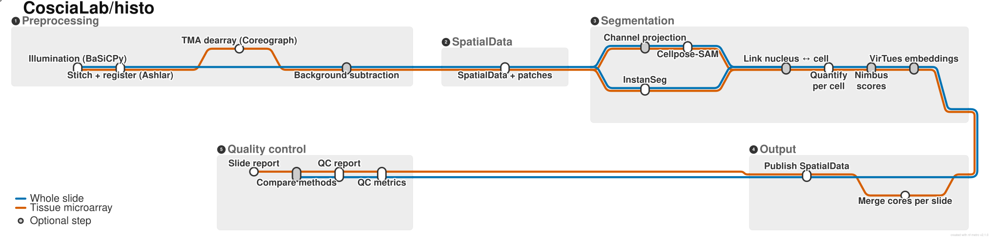

# Histo

[](https://www.nextflow.io/)
[](https://www.nf-test.com)
[](https://sylabs.io/docs/)

Processing, segmentation and quantification of multiplex immunofluorescence (mIF) and H&E images from the same tissue.
H&E is planned and not yet supported.

> [!WARNING]
> Pipeline is still in heavy development: features, inputs, and outputs will change.



## What it does

Preprocessing:

1. Illumination correction (BaSiCPy)
2. Stitching and registration (Ashlar)
3. TMA dearray (UNetCoreograph)
4. Background subtraction (backsub)

Downstream:

1. SpatialData Zarr conversion and channel naming from the marker sheet
2. Tiled segmentation of cells, nuclei or both, with Cellpose, InstanSeg or both
3. Resolve segmentation conflicts in tile overlaps
4. Nuclei are linked to their cells and the cytoplasm derived
5. Aggregation of channel intensity per cell, and per nucleus and cytoplasm
6. QC report per sample and method

## Usage

```bash
nextflow run CosciaLab/histo \
    -profile <docker/singularity/.../institute> \
    --input samplesheet.csv \
    -params-file params.yml
```

Needs Nextflow >= 25.10.4, a container engine and pre-staged images (no pulls at launch). Start `params.yml` from [assets/params_template_compact.yml](assets/params_template_compact.yml).

## Documentation

| Doc                                                                      | For         | Contents                                           |
| ------------------------------------------------------------------------ | ----------- | -------------------------------------------------- |
| [Website](https://coscialab.github.io/histo/)                            | users       | Guides, tutorials, inputs, outputs, modules        |
| [docs/usage.md](docs/usage.md)                                           | users       | Inputs, choosing parameters, profiles, the cluster |
| [assets/params_template_compact.yml](assets/params_template_compact.yml) | users       | Every parameter on one line, to edit               |
| [assets/params_template.yml](assets/params_template.yml)                 | users       | Every parameter with its full description          |
| [docs/output.md](docs/output.md)                                         | users       | What runs, what comes out, the QC report           |
| [docs/CONTRIBUTING.md](docs/CONTRIBUTING.md)                             | maintainers | Testing, containers, the metro map                 |
| [docs/decisions.md](docs/decisions.md)                                   | maintainers | Why it is built this way                           |
| [ROADMAP.md](ROADMAP.md)                                                 | maintainers | Open work, known limits, verified runs             |
| [CHANGELOG.md](CHANGELOG.md)                                             | both        | Release notes                                      |
| [CITATIONS.md](CITATIONS.md)                                             | both        | Tools to cite                                      |

## Credits

Written by Jose Nimo at the Max Delbrück Center for Molecular Medicine, Berlin.

This is a **personal pipeline, not an nf-core pipeline**, and is not affiliated with or endorsed by
nf-core. It follows nf-core conventions for reproducibility and to keep upstream contributions open.

This pipeline is derived from two MIT licensed projects and would not exist without them:

- **nf-core/sopa**, written by [Quentin Blampey](https://github.com/quentinblampey) and
  contributors. The downstream half of this pipeline is derived from it, and many modules are
  vendored from it with their original licence headers and source commits recorded.
- **nf-core/mcmicro**, from the Laboratory of Systems Pharmacology and the nf-core community.

See [`CITATIONS.md`](CITATIONS.md) for the full list of tools and their references.

## Citations

**This pipeline has no DOI and should not be cited in place of the tools it wraps.** If you use it,
cite the underlying tools. The two most important:

> **Sopa: a technology-invariant pipeline for analyses of image-based spatial omics.**
>
> Quentin Blampey, Kevin Mulder, Margaux Gardet, Stergios Christodoulidis, Charles-Antoine Dutertre,
> Fabrice André, Florent Ginhoux & Paul-Henry Cournède.
>
> _Nat Commun._ 2024 June 11. doi: [10.1038/s41467-024-48981-z](https://doi.org/10.1038/s41467-024-48981-z)

> **The nf-core framework for community-curated bioinformatics pipelines.**
>
> Philip Ewels, Alexander Peltzer, Sven Fillinger, Harshil Patel, Johannes Alneberg, Andreas Wilm,
> Maxime Ulysse Garcia, Paolo Di Tommaso & Sven Nahnsen.
>
> _Nat Biotechnol._ 2020 Feb 13. doi: [10.1038/s41587-020-0439-x](https://dx.doi.org/10.1038/s41587-020-0439-x)

## Licence

MIT. See [`LICENSE`](LICENSE).
